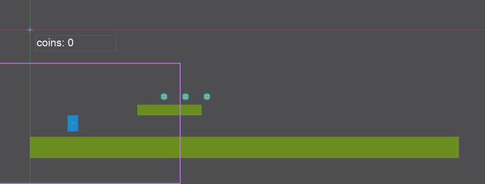
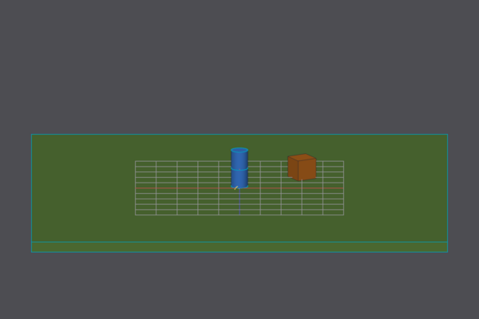
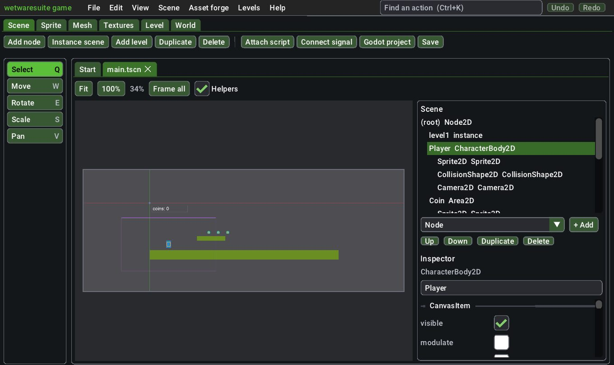

# Scenes: Godot-style game scenes

`scene` builds game scenes the way Godot's editor does: a tree of nodes, each with a class (Sprite2D, CharacterBody2D, Camera3D ...) and properties, plus the files and shapes they use. Scenes open and save as Godot 4 `.tscn` text files, so you can make a level, a player and a HUD here, open the folder in Godot and press Play, and a scene made in Godot opens and edits here. Properties this editor doesn't know about are kept as written, so a round trip doesn't lose anything.

It lives in the **game** app (the Scene tab) and works from the command line, scripts and Claude like every tool.

Each task below is shown as a batch script (run with `wetwaresuite batch file.txt`; `-> name` saves a result, `$name` reuses it, see [headless and batch](headless-and-batch.md)) and as a prompt for Claude over MCP (`wetwaresuite mcp --tools scene,levels,forge`, see [mcp.md](mcp.md)). Every example was run against the real binary in an empty folder; outputs are copied from those runs, with long folder names shortened.

## Contents

1. [The ideas you need](#1-the-ideas-you-need)
2. [Task: a 2D platformer screen you can run in Godot](#2-task-a-2d-platformer-screen-you-can-run-in-godot)
3. [Task: a small 3D world](#3-task-a-small-3d-world)
4. [Task: edit a scene made in Godot](#4-task-edit-a-scene-made-in-godot)
5. [Editing in the window](#5-editing-in-the-window)
6. [Values you can type](#6-values-you-can-type)
7. [Command reference](#7-command-reference)
8. [Play test without Godot](#8-play-test-without-godot)
9. [Limitations](#9-limitations)

## 1. The ideas you need

**Nodes and paths.** A scene is a tree with one root. Nodes are named by their path from the root, as in Godot's NodePath: `.` is the root, `Player` a child of it, `Player/Sprite2D` a grandchild. Names are unique among siblings; adding a second `Coin` makes `Coin2`.

**Classes.** Every node has a Godot class. `scene.classes` lists the ones this editor knows (2D: Node2D, Sprite2D, AnimatedSprite2D, Polygon2D, Line2D, Camera2D, the physics bodies and areas, CollisionShape2D/Polygon2D, TileMapLayer, lights, particles, audio players; UI: Control, Label, Button, ColorRect, TextureRect, ProgressBar, CanvasLayer; 3D: Node3D, MeshInstance3D, Camera3D, lights, the 3D bodies, VehicleBody3D and wheels, WorldEnvironment; and Node, Timer, AnimationPlayer). Each class inherits its parent's properties, so a Sprite2D has Node2D's `position`, `rotation`, `scale` and CanvasItem's `visible`, `modulate`.

**Properties.** You type values the easy way (`position=64,140`, `rotation=45`, `shape=rect:16x32`, `texture=art/hero.png`) and they are written the Godot way (`Vector2(64, 140)`, radians, a RectangleShape2D sub-resource, an ExtResource). Angles are degrees everywhere; Godot keeps radians in the file. 3D nodes are saved with Godot's `transform = Transform3D(...)` and read back as position, rotation and scale.

**The project.** Godot finds files by `res://` paths from the folder holding `project.godot`. `scene.project` writes one (name, main scene, window size, pixel-art filtering, renderer). Files you use in a scene are saved with `res://` paths when they are inside that folder.

**Instances.** A node can be another scene (`scene.instance`), like Godot's chain-link button. `scene.add_level` turns a tile level from [levels](levels.md) into its own `.tscn` (a TileMap with its TileSet and collision) and instances it, so you can paint the level and re-add it.

## 2. Task: a 2D platformer screen you can run in Godot

A player that runs and jumps, three coins, the ground as a tile level and a score label.

```text
# a Godot project with one screen: a player, three coins, a level and a score label
scene.project dir=. name=Coins main_scene=main.tscn width=640 height=360 pixel_art=true
# placeholder art (draw real art in the image or paint apps later)
photo.new width=16 height=24 background=#3a7bd5 -> hero
photo.save doc=$hero path=art/hero.png
photo.new width=8 height=8 background=#ffd23f -> coin
photo.save doc=$coin path=art/coin.png
# the ground, as a tile level
levels.new width=40 height=12 tile_width=16 layer=ground -> level
levels.tileset_placeholder doc=$level path=art/tiles.png style=autotile colors=#6b8e23 name=grass
levels.fill_rect doc=$level x=0 y=10 width=40 height=2 tile=15
levels.fill_rect doc=$level x=10 y=7 width=6 height=1 tile=15
# the scene
scene.new root=Node2D name=Main path=main.tscn -> s
scene.add_level doc=$s level=$level path=levels/level1.tscn
scene.add doc=$s type=CharacterBody2D name=Player props="position=64,140"
scene.add doc=$s type=Sprite2D parent=Player props="texture=art/hero.png"
scene.add doc=$s type=CollisionShape2D parent=Player props="shape=capsule:7x24"
scene.add doc=$s type=Camera2D parent=Player props="zoom=2,2; position_smoothing_enabled=true"
scene.script doc=$s node=Player path=player.gd template=character2d
scene.add doc=$s type=Area2D name=Coin props="position=200,100"
scene.add doc=$s type=Sprite2D parent=Coin props="texture=art/coin.png"
scene.add doc=$s type=CollisionShape2D parent=Coin props="shape=circle:5"
scene.script doc=$s node=. path=main.gd
scene.connect doc=$s signal=body_entered from=Coin to=.
scene.duplicate doc=$s node=Coin props="position=232,100"
scene.duplicate doc=$s node=Coin props="position=264,100"
scene.add doc=$s type=CanvasLayer name=HUD
scene.add doc=$s type=Label parent=HUD name=Score props="text=coins: 0; position=8,8; size=120,23"
scene.tree doc=$s
scene.save doc=$s
scene.preview doc=$s path=main.png
```

What it says (shortened):

```text
wrote ./project.godot: open the folder in Godot (Import) and press Play
...
wrote levels/level1.tscn and instanced it as level1
added Player (CharacterBody2D)
next: give it a shape, scene.add type=CollisionShape2D parent=Player props="shape=rect:16x32"
...
wrote player.gd and attached it to Player
...
wrote main.gd and attached it to Main
connected Coin.body_entered to Main._on_coin_body_entered()
added func _on_coin_body_entered() to main.gd
duplicated Coin as Coin2
duplicated Coin as Coin3
...
Main (Node2D) script main.gd
├─ level1 (instance of level1.tscn)
├─ Player (CharacterBody2D) script player.gd
│  ├─ Sprite2D (Sprite2D)
│  ├─ CollisionShape2D (CollisionShape2D)
│  └─ Camera2D (Camera2D)
├─ Coin (Area2D)
│  ├─ Sprite2D (Sprite2D)
│  └─ CollisionShape2D (CollisionShape2D)
├─ Coin3 (Area2D)
│  ...
├─ Coin2 (Area2D)
│  ...
└─ HUD (CanvasLayer)
   └─ Score (Label)
saved main.tscn
2D view 1200x457, world -44.76,-44.76 at the top left, 1.65856 px per unit
```



The picture is what Godot's 2D viewport shows: sprites, tiles, the label's box, collision shapes (cyan), the camera's frame (purple) and the world axes. Duplicates go right after the node they copy, as in Godot.

`main.tscn` is an ordinary Godot scene:

```text
[gd_scene load_steps=8 format=3]

[ext_resource type="PackedScene" path="res://levels/level1.tscn" id="1_level1"]
[ext_resource type="Texture2D" path="res://art/hero.png" id="2_hero"]
[ext_resource type="Script" path="res://player.gd" id="3_player"]
...
[sub_resource type="CapsuleShape2D" id="CapsuleShape2D_1"]
radius = 7.0
height = 24.0
...
[node name="Player" type="CharacterBody2D" parent="."]
position = Vector2(64, 140)
script = ExtResource("3_player")
...
[connection signal="body_entered" from="Coin" to="." method="_on_coin_body_entered"]
```

`player.gd` starts as Godot's own CharacterBody2D template (gravity, jump on `ui_accept`, left and right on the arrow keys). Open the folder in Godot (Import, pick `project.godot`) and press F5: the player falls onto the grass and runs and jumps. Fill in `_on_coin_body_entered` in `main.gd` to count coins.

**With Claude:** "Make a Godot project in ~/games/coins with a platformer player, three coins and some ground, then show me the scene." Claude calls `scene_project`, `levels_new`, `levels_tileset_placeholder`, `scene_new`, `scene_add_level`, `scene_add` (several times), `scene_script`, `scene_connect`, `scene_save` and `scene_preview`.

## 3. Task: a small 3D world

```text
scene.new root=Node3D name=World path=world.tscn -> s
scene.add doc=$s type=StaticBody3D name=Ground
scene.add doc=$s type=MeshInstance3D parent=Ground props="mesh=box:20x0.5x20; material_override=#5a7d3a; position=0,-0.25,0"
scene.add doc=$s type=CollisionShape3D parent=Ground props="shape=box:20x0.5x20; position=0,-0.25,0"
scene.add doc=$s type=CharacterBody3D name=Player props="position=0,1,0"
scene.add doc=$s type=MeshInstance3D parent=Player props="mesh=capsule:0.4x1.8; material_override=#3a7bd5"
scene.add doc=$s type=CollisionShape3D parent=Player props="shape=capsule:0.4x1.8"
scene.add doc=$s type=Camera3D parent=Player props="position=0,1.5,4; rotation=-15,0,0; current=true"
scene.add doc=$s type=DirectionalLight3D name=Sun props="rotation=-50,30,0; shadow_enabled=true"
scene.add doc=$s type=MeshInstance3D name=Crate props="mesh=box:1x1x1; position=3,0.5,-2; rotation=0,30,0; material_override=#b5651d"
scene.script doc=$s node=Player path=player3d.gd template=character3d
scene.save doc=$s
scene.preview doc=$s path=world.png
scene.preview doc=$s camera=true path=world_cam.png
scene.open path=world.tscn -> t
scene.inspect doc=$t node=Crate
```

The crate is saved as `transform = Transform3D(0.866025, 0, 0.5, 0, 1, 0, -0.5, 0, 0.866025, 3, 0.5, -2)` and comes back as:

```text
Crate (MeshInstance3D)
Node3D:
  position = 3, 0.5, -2  - metres from the parent, y up
  rotation = 0, 30, 0  - degrees about x, y, z
  scale = 1, 1, 1  (default)
  visible = true  (default)
GeometryInstance3D:
  cast_shadow = on  (default) [off, on, double_sided, shadows_only]
MeshInstance3D:
  mesh = box:1x1x1  - box:WxHxD, sphere:R, cylinder:RxH, capsule:RxH, plane:WxD or a .obj file
  material_override = #b5651d  - a plain colour for the whole mesh
```

`camera=true` looks through the current Camera3D (Godot's Preview checkbox):



**With Claude:** "Add five crates in a row in front of the player in world.tscn and turn each one a bit more." Claude calls `scene_open`, `scene_add` or `scene_duplicate`, then `scene_transform node=Crate2 rotate=15 axis=y` and so on, and `scene_save`.

## 4. Task: edit a scene made in Godot

```text
scene.open path=enemy.tscn -> e
scene.tree doc=$e
scene.inspect doc=$e node=Hitbox/Shape
scene.set doc=$e node=Hitbox/Shape props="shape=rect:20x28"
scene.set doc=$e node=. props="groups=enemies"
scene.save doc=$e
```

Everything in the file that this editor doesn't model (extra properties, uids, editable children, overrides inside instances, resources it doesn't know) is written back as it was. `scene.inspect` lists such properties under `other:`.

## 5. Editing in the window

Open a `.tscn` in the game app (File > Open), or start one with Start something new > New Scene.



- **Tools on the left**, with Godot's letters: **Select (Q)** clicks a node to select it (clicks on an instanced scene pick the instance) and drags it; **Move (W)** drags the selected node; **Rotate (E)** turns it around its middle; **Scale (S)** resizes it, dragging away from or towards the middle; **Pan (V)** moves the view. Hold **Ctrl** to snap moves to 8 pixels and turns to 15 degrees. Right or middle drag pans and the wheel zooms with any tool. Each drag is one undo step.
- **Keys:** Delete removes the selected node, Ctrl+D duplicates it, F frames everything (or the **Frame all** button), Ctrl+Z undoes.
- **The Scene dock** on the right is the node tree. Pick a class in the box and **+ Add** puts a child under the selected node; **Up** and **Down** reorder it among its siblings (later siblings draw on top); **Duplicate** and **Delete** do what they say.
- **The Inspector** under it shows the selected node's properties grouped by the class they come from, greyed when they are still Godot's default. Tick boxes, colour swatches, drop-downs for choices and drag fields for numbers and vectors apply as soon as you let go; text fields (files, shapes, meshes, text) apply when you press Enter or click away. The name field at the top renames the node. At the bottom, **Attach script** writes a starter GDScript (empty, character2d, topdown2d, character3d or area) next to the scene, and **Groups** sets the node's groups.
- **3D scenes** draw from an orbiting view: drag with Select to orbit, or use the turn and tilt sliders. Pick nodes in the Scene dock, then Move drags them across the ground (Shift: up and down), Rotate turns them about the vertical axis and Scale resizes them. **Camera view** looks through the Camera3D.
- **Helpers** hides collision shapes, cameras and markers in 2D.
- **Play** (F5) runs a 2D scene in the viewport; see [Play test without Godot](#8-play-test-without-godot).

The buttons along the top (Add node, Instance scene, Add level, Attach script, Connect signal, Godot project, Save) open the full forms for those commands.

## 6. Values you can type

| Kind | Examples | Written as |
| --- | --- | --- |
| numbers, angles | `45`, `0.5` | angles go to radians |
| 2D and 3D vectors | `64,140`, `0,1.5,4` | `Vector2(64, 140)`, `Vector3(...)` |
| colours | `#ff8080`, `#ff808080`, `red` | `Color(1, 0.5, 0.5, 1)` |
| files | `art/hero.png`, `res://art/hero.png` | an ExtResource with a `res://` path |
| 2D shapes | `rect:16x32`, `circle:8`, `capsule:7x24`, `segment` | a Shape2D sub-resource |
| 3D shapes | `box:1x2x1`, `sphere:0.5`, `capsule:0.4x1.8`, `cylinder:0.5x2` | a Shape3D sub-resource |
| meshes | `box:1x1x1`, `sphere:0.5`, `cylinder:0.5x2`, `capsule:0.4x1.8`, `plane:10x10`, `crate.obj` | a primitive mesh, or the file |
| choices | `cast_shadow=off` | the index Godot stores |
| reset | `modulate=default` | the property is removed |

Several at once: `props="position=10,20; rotation=15; modulate=#ffd0d0"`. `script=player.gd` attaches a script, `script=none` detaches it, `groups=a,b` sets groups.

## 7. Command reference

| Command | What it does |
| --- | --- |
| `scene.new` | A new scene with a root of some class (`root=Node2D name=Main path=main.tscn`). |
| `scene.open` / `scene.save` / `scene.close` | Open a `.tscn`, save it (optionally to a new `path`), close it. |
| `scene.project` | Write `project.godot` (name, main scene, window size, `pixel_art`, renderer). |
| `scene.tree` | The node tree (fields `nodes`, `types`, `count`, `dims`). |
| `scene.classes` | The classes you can add (`dims=2` or `3`, `base=PhysicsBody2D`). |
| `scene.add` | Add a node: `type`, `name`, `parent`, `props`, `index`. |
| `scene.set` | Change properties (`props="k=v; k=v"`), script and groups. |
| `scene.inspect` | A node's properties with defaults, kinds and docs (fields `names`, `values`, `kinds`, `sections`, `choices`, `script`, `groups`). |
| `scene.remove` / `scene.rename` / `scene.move` / `scene.duplicate` | Tree edits; `move` takes a new `parent` and/or `index`. |
| `scene.transform` | Move by a world-space `dx`/`dy`(/`dz`), turn by `rotate` degrees (3D: about `axis`), `scale` by a factor; what the viewport's drags do. |
| `scene.instance` | Put another `.tscn` in as a node. |
| `scene.add_level` | Export a level (open id or map file) as its own Godot scene and instance it. |
| `scene.script` | Write a GDScript from a template and attach it, or attach an existing one. |
| `scene.connect` | Connect a signal to a method (`remove=true` disconnects); adds the method to the target's script when it's missing. |
| `scene.preview` | The viewport picture: 2D fitted or a fixed view (`origin_x`, `origin_y`, `scale`, `width`, `height`), 3D orbit (`angle`, `tilt`) or `camera=true`; reports the selected node's box. |
| `scene.hit` | Which 2D node is drawn at a world point. |
| `scene.play` | Run a 2D scene for `seconds` with keys over time (`input=`); reports bodies and events, writes a `.gif` or `.png`. |
| `scene.play_step` | Advance a live play test by one step with the `keys` held (`restart`, `stop`). |

## 8. Play test without Godot

A 2D scene can be run right here for a quick check, like pressing F6 in Godot. GDScript isn't run; instead the suite recognises the starter scripts it writes (and the ones Godot writes for a CharacterBody2D):

- a script with `is_on_floor()` or gravity is a **platformer**: left and right move, Space or Up jumps. `SPEED` and `JUMP_VELOCITY` are read from the script.
- a script with `Input.get_vector` is a **top-down** mover.
- **RigidBody2D** falls (with `gravity_scale`) and lands; **StaticBody2D**, **AnimatableBody2D** and levels added with `scene.add_level` are solid (one-way platforms too).
- **Area2D** reports bodies going in. When the method its `body_entered` signal is connected to calls `queue_free()`, the area goes away (coins and pickups); `body.queue_free()` frees the body and `$Name.queue_free()` that node.
- the first enabled **Camera2D** frames the view (zoom, offset, limits) and **CanvasLayer** children (the HUD) stay put on screen.

**In the window:** press **Play** on the scene toolbar (or **F5**). Arrow keys move, Space or Enter jumps, **Esc** (or Stop) ends it. Notes about what the test leaves out and the latest events show over the game.

**As a batch script or for Claude:** `scene.play` runs for some seconds with keys held over times and reports where every body ended up:

```text
scene.open path=main.tscn -> scn
scene.play doc=$scn seconds=6 input="right 0.3-2.2; jump 0.9; jump 1.6; right 2.6-4.5; jump 3.3" fps=15 scale=1 path=run.gif
```

```text
played 6 s
Player (CharacterBody2D): gone, last at 1074, 2224
Crate (RigidBody2D): at 420, 152, on the floor
1.07 s: Player entered Coin3 -> _on_body_entered(), Coin3 freed
5.15 s: Player fell out of the level
wrote run.gif
```

`path=` writes an animated `.gif` of the run (or a `.png` of the last frame), and the fields (`Player.x`, `Player.on_floor`, `events`, `freed`) make it easy to check a level in a script: "can the player reach the flag?". `scene.play_step keys=right,jump seconds=0.033` advances a live run one frame at a time (what the window does); `restart=true` starts over and `stop=true` ends it.

> Play-test main.tscn: hold right for 3 seconds and jump at 1 second. Did the player pick up any coins? Show me the GIF.

## 9. Limitations

- The viewport draws with the suite's software renderer: no shaders, lighting or particles; 3D views are orthographic and only primitive meshes, `.obj`/`.glb` files and collision shapes draw.
- The play test is a quick check, not Godot: scripts other than the starter ones don't run (bodies with other scripts stand still and a note says so), shapes collide as their axis-aligned boxes, tiles are solid only when they come from a [levels](levels.md) map (a Godot TileSet's own physics isn't read), and 3D scenes don't play. Press Play in Godot for the real game. Scripts are written as starting points; editing them happens in the code app or Godot.
- AnimationPlayer tracks, TileSet editing, theme resources and materials beyond a plain colour are kept when a file goes through, but not edited here (use [levels](levels.md) for tiles and [forge](forge.md) for sprite sheets).
- 3D nodes can't be clicked in the viewport yet; pick them in the Scene dock.
